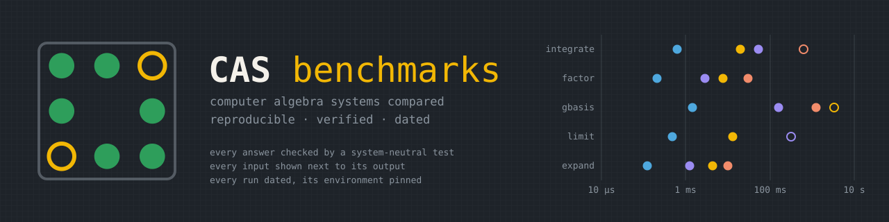

# Computer algebra system benchmarks



[](https://github.com/casbench/casbench.github.io/actions/workflows/ci.yml)
[](https://casbench.github.io/)

Reproducible, verified and dated benchmarks of computer algebra systems:
Julia packages (Giac.jl, Symbolics.jl, SymJ.jl, Groebner.jl, Primes.jl,
LibPARI.jl, msolve through AlgebraicSolving.jl), Python's SymPy, and Maxima,
FriCAS, SageMath, Macaulay2 and the JavaScript Compute Engine (MathJSON)
driven as processes from the same harness.
Fixed inputs stored in the repository, one adapter per system, every answer
checked by a system-neutral test, every run dated with its environment
pinned. The nine benches with committed results cover FFI overhead, CAS
operations, integer factorisation, functional coverage, a problem suite, a
sample of the 12000.org integration tests, Gröbner bases, the integration
rules of OpenSymbolicRules, and throughput at scale. Bench J adds rational
univariate representations; no run for it is committed yet.

**Results, per case and per system: https://casbench.github.io/**

> [!IMPORTANT]
> An individual, non-commercial project. The numbers are dated: they were
> measured on a shared virtual machine with the package versions recorded in
> `results/machine.txt`, and the systems compared are moving quickly. A
> status is a claim to check against the results files, not a verdict on a
> system. An unsolved or wrong case may hide an error of the benchmark
> itself, a command generated wrongly for that system; every case page of the
> site therefore shows the exact input sent to each system next to its
> output, and every results file has an `input` column (runs from
> 2026-11-20). Corrections of a task that does not ask a system the way its
> users would are welcome: open an issue or a pull request with the idiom.
>
> Disclosure: every contributor declares their relation to the
> systems compared and to the sources of the problems in
> `docs/disclosures.tsv` (the author of these benchmarks maintains Giac.jl,
> one of the systems compared, and wrote LibPARI.jl and OpenSymbolicRules:
> the Julia packages, not the engines), and their use of AI assistants (the
> harness, adapters, task files, checks, site and documentation were written
> with an AI assistant; earlier changes were reviewed by the contributor and
> the current reorientation awaits contributor review. Measurements come
> from the scripts). Rendered with the relation to every system:
> https://casbench.github.io/disclosures/
> See [CONTRIBUTING.md](CONTRIBUTING.md).

They are the reproduced numbers of the JuliaCon Proceedings paper on Giac.jl
(in preparation for 2027), whose repository includes this one as a git
submodule.

```
A_ffi/ ... J_rur/   the benches (inputs, problems, task files)      docs/benches.md      what each measures
lib/                harness, adapters, checks                          docs/methodology.md  how a run is made
envs/               one pinned Julia environment per system            results/<host>/      runs, machine; history and REFERENCE
tables/ figures/    generated for the paper                            site/ tools/site/    the project site
Giac.jl/ osr/       git submodules pinned to the commits measured
```

## Quick start

```sh
git clone --recurse-submodules https://github.com/casbench/casbench.github.io
nix run .#bench            # every bench, then the tables (Julia 1.13, SymPy, Maxima, FriCAS, Sage, Macaulay2 from nixpkgs)
nix run .#bench -- A G     # a subset
nix run .#bench -- A-interfaces  # comparable interface-path calls
```

Without Nix: `julia --startup-file=no run_all.jl` with Julia 1.13, a Python 3
with `sympy` (`JULIA_PYTHONCALL_EXE`, `JULIA_CONDAPKG_BACKEND=Null`) and the
CAS binaries on `PATH`. Details, time limits, the status vocabulary and the
adapters: [docs/methodology.md](docs/methodology.md).

For a running Linux campaign, the optional read-only observer and local
dashboard are documented in [docs/observability.md](docs/observability.md).
Notes on the GrobX Gröbner benchmarks and a possible adapter are in
[docs/grobx-review.md](docs/grobx-review.md).

Written with AI assistance. The reorientation changes await contributor review;
see [Disclosures](docs/disclosures.tsv). The paper and `CITATION.cff` say how
to cite.

## Licence

- **Code** (the harness, the adapters, the table and site generators, the
  benches' scripts): MIT, see `LICENSE`.
- **Data and site content** (the fixed inputs we assembled, `results/`,
  `tables/`, `figures/`, the generated pages): Creative Commons Attribution
  4.0 International (CC BY 4.0), see `LICENSE-DATA`. Cite the repository (or
  `CITATION.cff`) and the run date of the numbers you reuse.
- **Third-party statements**: the problem statements of bench E are those of
  the fork notebook cited in `docs/benches.md`; the entries of `F_integration/sample.tsv`
  are quoted from the 12000.org test files (themselves from the Rubi test
  suite, MIT, and the collections they cite), with the file and line of each;
  `H_osr/rules.tsv` derives from OpenSymbolicRules (MIT); the polynomial
  systems of benches G and J are the classical ones of the literature (Katsura,
  cyclic-n, eco, noon, Henrion, Chandrasekhar), whose strings were generated
  once with the `Examples` module of Groebner.jl (GPL-2.0; the strings are
  the systems themselves, not that code); the fork notebook of bench E is
  under GPL-3.0 like Giac.jl. Their own terms apply to them.
- The structure of the adapters follows SymJ.jl's comparison (MIT).
